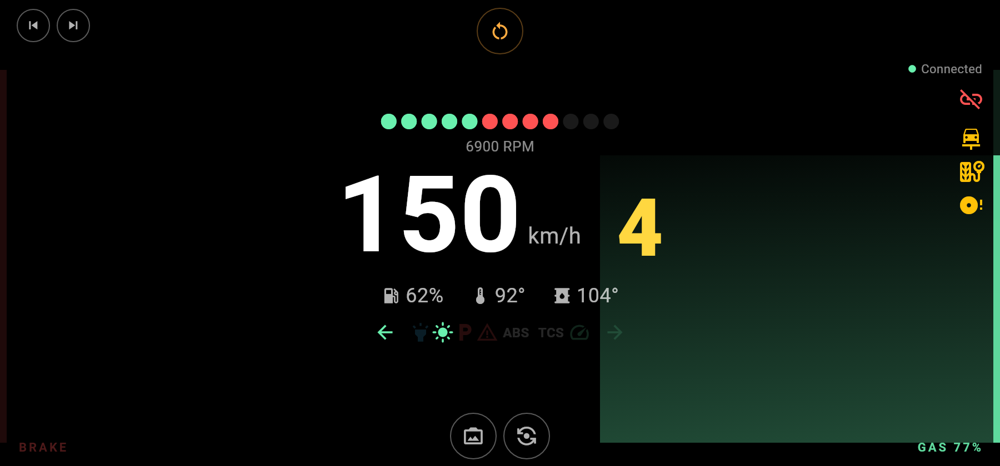
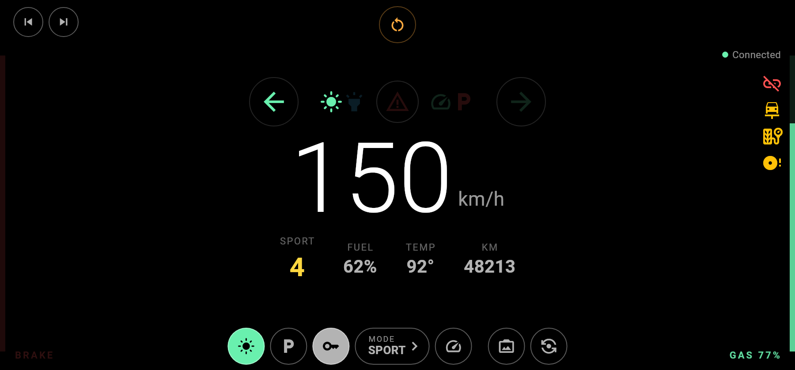
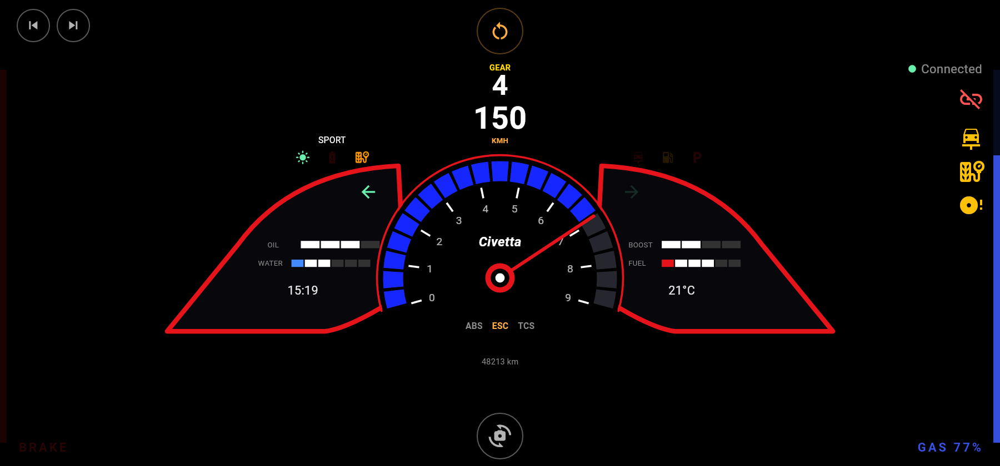
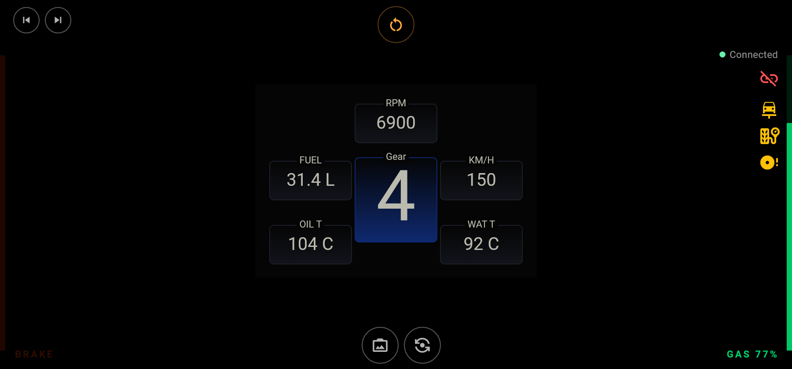
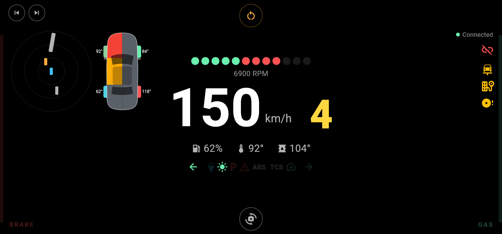
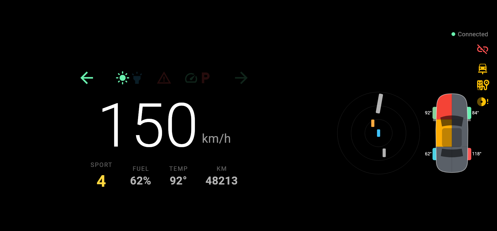
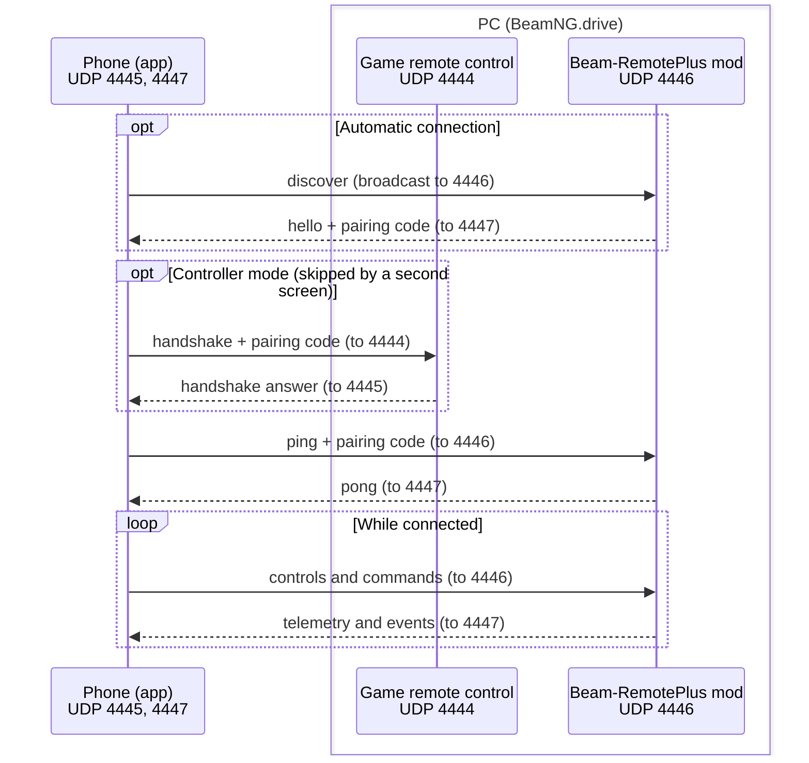

# Beam-RemotePlus — Android app

**Drive [BeamNG.drive®](https://www.beamng.com/) with your phone**: tilt to
steer, slide your thumbs to brake and accelerate, and watch a live dashboard
of your car.

**Beam-RemotePlus** (not "BeamNG-RemotePlus") is a **community project**: a
free, open source app and mod made by players. It is **not an official
BeamNG product** and is not affiliated with, endorsed or supported by
BeamNG GmbH. It replaces BeamNG's former phone controller,
[BeamNG/remotecontrol](https://github.com/BeamNG/remotecontrol), which is no
longer maintained.

> **Install the mod too.** Most features need the
> [Beam-RemotePlus mod](https://github.com/LucienLassalle/Beam-RemotePlus-Mod)
> in the game. Without it, the app only offers what the game's native remote
> control channel allows: steering and on/off pedals.

## Gallery

| Default | Road |
|---|---|
|  |  |
| **Civetta** | **F4** |
|  |  |
| **Radar & damage panel** | **Second screen** |
|  |  |

## Features

- **Steering** by tilting the phone like a wheel (with the gyroscope when
  the phone has one, quicker and steadier), with a touch bar, or with a
  wheel turned by a thumb.
- **Analog pedals** with both thumbs.
- **Dashboard themes**, easy to make: [THEMES.md](THEMES.md).
- **Vehicle buttons**: indicators, hazards, horn, lights, parking brake,
  ignition, drive mode (in the game's color), cruise control, camera,
  vehicle switching, reset. Volume buttons for the horn and the headlight
  flash (on the F4 theme: DRS and Push-to-Pass). On the Road theme, indicators and hazards are pressed right on the
  dashboard, and police cars, ambulances, fire trucks and pace cars get
  their emergency lights and siren.
- **Warning lights** like a real car (engine, oil, temperature, fuel or
  battery, tyres, brakes, clutch, gearbox...).
- **Vibrations**: wheelspin, locked wheels, impacts, kerbs, ABS, rev limiter.
- **Radar and damage view**: the cars around, and the real structure of your
  vehicle with its bent parts, tyres and brakes.
- **Electric cars**, **second screen** (dashboard only, next to a wheel or a
  gamepad) and **local multiplayer** (one phone per player).
- **Automatic connection** on the local network, or pairing code / QR code.
- **Safe disconnection**: when the phone loses the Wi-Fi for a second or the
  player leaves, the car no longer accelerates and brakes for 5 seconds
  (with the mod).
- **English and French** ([TRANSLATING.md](TRANSLATING.md)).
- **Update check**: the home screen says when a newer app is out, and once
  connected the app says whether the app or the mod should be updated (they
  should be the same release).

### Optional vehicle mods

When you drive one of these vehicle mods (BeamNG.drive repository), the
**F4** theme adds its race controls: the pit limiter on screen (PIT), the DRS
on volume up and the Push-to-Pass on volume down; nothing changes with other
vehicles and none of these mods is needed:

| Vehicle mod | Controls |
|---|---|
| **CF26** (add-on of the F4, its F3 configurations) | DRS (volume up), Push-to-Pass (volume down), pit limiter (PIT) |
| **Carbonworks F4** by LucasBE (fr04) | pit limiter (PIT) |
| **FR17** | DRS (volume up) |

With a tyre thermals mod, the damage view also shows the temperature and
wear of each tyre: **Tyre Wear and Thermals Redux** (maintained) or the
original **Luuks Tyre Thermals and Wear Mod** (unsupported since 2024).

The **Optional mods** list (puzzle icon on the home screen, or *Optional
mods* in the help while driving) shows these mods and, once connected,
whether each one is enabled, installed but disabled, or not installed in
the game.

## Installation

1. Download the APK from the
   [latest release](https://github.com/LucienLassalle/Beam-RemotePlus-Mobile/releases/latest)
   (Android 7.0 or newer): `arm64-v8a` for almost every recent phone,
   `universal` if unsure.
2. Install the [mod](https://github.com/LucienLassalle/Beam-RemotePlus-Mod)
   in BeamNG.drive and enable it in the mod manager.
3. Put the phone on the same Wi-Fi as the PC (or share the phone's hotspot
   with the PC), load a level and tap **Automatic connection**.

## Network

The app talks to the PC on your local network only. The one exception is
the **update check**: at launch, the app asks the GitHub API
(`api.github.com`) for the latest release of the app and of the mod; it
sends nothing else, and it can be turned off in Settings > Advanced > *Check
for updates*. Without internet, the releases seen at the last check are
used.

The app uses four UDP ports:

| Port | Listens on | Used for |
|---|---|---|
| UDP **4445** | phone (the app) | the game's answer to the pairing handshake |
| UDP **4447** | phone (the app) | hello, pong, telemetry and events from the mod |
| UDP **4444** | PC (the game's own remote control) | pairing handshake, then basic steering/pedals until the mod answers |
| UDP **4446** | PC (the [mod](https://github.com/LucienLassalle/Beam-RemotePlus-Mod#network)) | discovery, ping, controls (60 Hz), commands |

- A **second screen** only uses 4446 and 4447.
- Nothing has to be opened on the phone. If the phone cannot find the PC,
  allow incoming UDP 4444 and 4446 on the PC (see the
  [mod README](https://github.com/LucienLassalle/Beam-RemotePlus-Mod#network)).

## Contributing

New themes, translations and fixes are welcome through pull requests, in
English or French: [CONTRIBUTING.md](CONTRIBUTING.md). Only Podman is needed
to build and test.

## License

[CC BY-NC-SA 4.0](LICENSE): share and adapt for non-commercial purposes, with
attribution, under the same license. Beam-RemotePlus complies with the
BeamNG.drive EULA and grants BeamNG GmbH the rights its § 11 asks for: see
[BEAMNG-EULA.md](BEAMNG-EULA.md).

BeamNG.drive is a registered trademark of BeamNG GmbH. Beam-RemotePlus is an
independent community project, not affiliated with or endorsed by BeamNG
GmbH.
